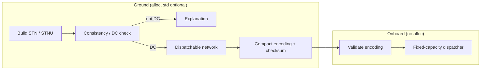

# temporal-control: design

## 1. Purpose and boundaries

`temporal-control` is a narrow, verifiable component: it decides whether a set of timing
constraints can be met, derives an executable strategy, and executes it onboard. It is meant to
be adopted by an existing flight executive (F Prime, cFS) through thin adapters. It is not a
planner, not an executive, and it does not reason about resources.

Non-goals: activity selection (mission planner), resource safety (`resource-timeline`),
physical-state safety (`polyzonotope-reach`), fault protection (the executive).

## 2. Time model

- Time is an integer number of `Ticks(i64)`. The tick length is fixed by the integrator.
- No floating point anywhere: results are bit-identical on every target.
- All arithmetic is checked. Overflow is a reported error (`Error::Overflow`), never a wrap or
  a saturation that could silently change a verdict.
- `i64::MIN` is not a valid lower bound because its negation is not representable;
  construction rejects it.

## 3. Formal semantics

### 3.1 Simple Temporal Network (STN)

An STN is a pair `S = (T, C)` of time points `T = {t_0, ..., t_{n-1}}` and binary constraints
`c = (t_i, t_j, lo, hi)` meaning `lo <= t_j - t_i <= hi`, where `lo, hi` are in
`Z ∪ {-∞, +∞}` (Dechter, Meiri and Pearl 1991).

A *schedule* is a function `σ: T -> Z`. It *satisfies* `S` if every constraint holds for
`σ(t_j) - σ(t_i)`. `S` is *consistent* iff some schedule satisfies it.

**Distance graph.** `G(S)` has one vertex per time point and, per constraint,

- an *upper edge* `t_i -> t_j` with weight `hi` (if `hi` is finite), and
- a *lower edge* `t_j -> t_i` with weight `-lo` (if `lo` is finite).

An edge `u -> v` with weight `w` encodes `t_v - t_u <= w`. Parallel edges are allowed; only the
smallest weight per ordered pair matters. Self-loops are allowed; a self-loop with negative
weight is a one-edge negative cycle.

**Theorem (DMP 1991, Theorem 3.1).** `S` is consistent iff `G(S)` has no negative cycle. If
it is consistent, `σ(t) = d(s, t)` (shortest distance from a virtual source `s` with
zero-weight edges to all time points) satisfies `S`. DMP's proof and Corollary 3.2 use the
distances from a time point `X_0` instead (latest and earliest schedules); the virtual source
is our adaptation, which needs no reference point that reaches every other.

**Minimal network.** For a consistent `S`, let `D[i][j]` be the shortest-path distance
`t_i -> t_j` in `G(S)` (`+∞` if none). The minimal network replaces each pair's interval with
`[-D[j][i], D[i][j]]` (DMP Corollary 3.5). It is the tightest equivalent STN: for every pair
and every value `x` in that interval, some satisfying schedule has `σ(t_j) - σ(t_i) = x`
(decomposability, DMP Theorem 3.3). In particular each bound is attained (*tightness*), which
the property tests check.

**Partial path consistency.** `Stn::partial_path_consistency` computes the same bounds only for
the pairs of a chordal supergraph of the constraint graph (every constrained pair plus fill
edges), with P³C (Planken, de Weerdt and van der Krogt 2008). A pair of interest that shares no
constraint is added as a constraint without bounds.

**Explanation of inconsistency.** A negative cycle `e_1, ..., e_k` in `G(S)`, where every edge
is named by `(ConstraintId, Bound::{Upper, Lower})`. Summing the encoded inequalities around the
cycle gives `0 <= Σ w(e_i) < 0`, a contradiction. So the named constraint bounds are a
certificate of inconsistency that anyone can recheck without trusting the solver. The cycle
found is simple (each vertex at most once) but not necessarily minimum in size or weight.

### 3.2 STN with Uncertainty (STNU)

An STNU adds *contingent links* `(A, l, u, C)` with `0 < l <= u < ∞` (Morris, Muscettola and
Vidal 2001, who require `0 < l < u`; Morris 2014 allows `0 <= l < u`): once the activation point `A` is executed, nature sets the contingent point `C` to
some time in `[A + l, A + u]`. The agent only learns `C` when it happens. Contingent points
are distinct: each is the target of exactly one contingent link (`Stnu::add_contingent_link`
creates it), and the agent never executes it. Activation points may themselves be contingent
(chains). The remaining constraints are *requirement* constraints, as in an STN. `l = u` is
accepted (a degenerate but harmless link); `l = 0` is rejected.

A *situation* `ω` fixes every contingent duration. A *dynamic execution strategy* decides, at
each time, which executable time points to execute, using only the contingent durations
observed so far.

**Dynamic controllability (DC).** An STNU is DC iff there is a dynamic strategy that satisfies
all requirement constraints in every situation.

**Reaction-time semantics (decided).** Time is integer ticks. Within one tick, nature's
contingent events happen first, then the agent decides, so an observation at tick `t` may
trigger an execution at the same tick `t` (*instantaneous reaction at tick granularity*).
Formally, the agent's choice at `t` may depend on every contingent time `<= t`.

Relation to the literature (section 12). MMV 2001 let a decision depend on contingent
durations that finished strictly before the point being decided ("not on those in the future
(or present)"). Hunsberger (TIME 2009) showed that comparing pre-histories relative to time
points admits strategies with advance knowledge (counter-example `N!`) and fixed it by
comparing them relative to times: a DES* decides at time `k` from the contingent events
strictly before `k`. Morris (CPAIOR 2014) keeps Hunsberger's time-based histories but includes
the present ("the agent can react instantaneously"), which is the variant whose rules this
crate implements. So `SameTick` is Morris 2014's semantics on integer times, and `NextTick`
is the discrete analogue of Hunsberger's DES*: the reaction takes one tick instead of an
arbitrarily small time. All three papers reason over real-valued schedules; that the
checkers decide the integer-time game exactly rests on the brute-force oracle tests, not on a
theorem.

This reverses the intent previously written here (decide only on observations strictly before
`t`, i.e. react at `t + 1`). Reasons:

- The edge-generation rules implemented (no-case, upper-case, lower-case with a strictly
  negative tail, cross-case, label removal) decide exactly this variant. The test suite checks
  every checker against a brute-force solver of the integer-time game with both move orders:
  they match the same-tick game on random small STNUs. Example: `A => C [1, 10]` with
  `t_X = t_C` is DC under same-tick reaction and not DC under next-tick reaction.
- A first attempt at a next-tick variant (making the lower- and cross-case conditions
  non-strict) did not match the next-tick game on contingent chains and was dropped. Missing
  piece, in hindsight: label removal would also have needed the `ε` shift.

Consequence for integrators: the executive must hand observations of tick `t` to the dispatcher
before asking it what to execute at `t` (`Dispatcher::step` does this). If the platform can only
react one tick later, the guarantees do not hold. Next-tick DC implies same-tick DC (also
tested).

**Next-tick reaction (done, `Stnu::with_reaction(Reaction::NextTick)`).** Instead of new rules,
a transformation: replace every contingent point `C` by its observation `C' = C + 1`. A link
from an executable point becomes `[lo + 1, hi + 1]`, a link from a contingent point keeps its
bounds (both ends move), and requirements are rewritten with `C = C' - 1`. A same-tick agent
of the new network sees exactly what a next-tick agent of the old one sees, so every checker
and dispatchable-network algorithm applies unchanged; the tests check all checkers against the
next-tick game, including contingent chains, and simulate the resulting networks. Executing it
needs an executive that hands each observation to the dispatcher one tick late, as the shifted
point.

### 3.3 Dispatchable networks and execution

A network is *dispatchable* if a greedy dispatcher that only propagates to immediate neighbors
never violates a constraint (Muscettola, Morris and Tsamardinos, KR 1998). That paper was not
available; the definition, the filtering rules and the minimality result below are as Morris
(CPAIOR 2014, section 5) restates them.

**STN.** `MinimalNetwork::dispatchable` filters the minimal network (by the restated MMT result
the outcome is minimal except for the edge copies on simultaneous points described below; not
checked against MMT itself, and minimality is not tested). Rigid components
(`D[i][j] + D[j][i] = 0`) get a leader, their earliest member (lowest index on ties); members are
tied to it by two edges. Among leaders, a non-negative edge `A -> C` is dropped if a
non-negative `B -> C` has `D[A][B] + D[B][C] = D[A][C]`, a negative `A -> C` if a negative
`A -> B` does. Members at offset zero from their leader get a copy of every kept leader edge so
that their window always equals the leader's (otherwise they could run first with an
unconstrained window). Tests check that the filtered network has the same minimal network as
the original, and that random, earliest and latest agents never fail.

**STNU.** `Stnu::dispatchable` returns an *extended* network: ordinary edges plus *waits*
`(X, C, δ)`, upper-case edges `X -> A_C` of weight `-δ`: `X` must not execute before `A_C + δ`
unless `C` was observed. `DispatchAlgorithm` picks the source:

- `Morris2014`: Morris's dispatchable variant of his DC algorithm, which inserts every ordinary
  edge and wait its backpropagation derives (one upper-case pass per link activated at a node,
  then one ordinary pass; no normal form, as in CSTNU-Tool's `applyMorris2014Dispatchable`).
  `O(n m + n^3)` for `k <= n`.
- `Minimal` (default): `Morris2014` followed by `minDispESTNU` (Hunsberger and Posenato, ICAPS
  2024): stand-in edges, STN dominated-edge filtering, removal of the remaining stand-ins and of
  dominated waits. The paper's diamond stand-ins are left out: they are only entailed through
  propagation along waits, which the paper's `RTE*` executor does and this dispatcher does not;
  with them a deadline was lost (regression test). So the output is smaller than Morris's
  (about 15-20 % fewer edges and waits on the random test networks, a quarter of the
  closure's) but not proven minimal. `O(k n^3)`.
- `Closure`: the all-pairs labelled closure (unbounded rounds), kept as the reference.

All three are checked by simulating the dispatcher under every agent and nature policy against
every requirement. For `Morris2014` and `Minimal` this is the only evidence of
dispatchability (section 12.1); the closure is the reference.

**Execution semantics (onboard, `Dispatcher<N, E>`).** Per time point: a window `[lb, ub]`, the
number of unhappened heads of its *precedence* edges (edges of negative weight), and the time it
happened. When a point happens at `t`, only its own edges propagate: `x -> y` with weight `w`
gives `ub[y] <= t + w`, and `y -> x` gives `lb[y] >= t - w`. An executable point may execute at
`now` iff all its precedence heads happened, `lb <= now <= ub`, and each of its waits is
released (contingent observed, or activation happened at `a` and `now >= a + δ`). A tick
(`step`) ingests observations, reports missed deadlines and overdue contingent points, then
executes as soon as possible; `can_execute`/`execute` let an executive choose later times
itself. Errors are typed: missed deadline, contingent out of bounds (assumption violated),
constraint violated or empty window (the network was not dispatchable), time going backwards,
capacity. Observations are recorded even when they violate an assumption, so monitoring
continues. The dispatcher never panics on any input; all tick arithmetic is checked.

**Construction and storage (onboard).** `Dispatcher<N, E, I = usize>` is a plain
fixed-capacity struct. `Dispatcher::EMPTY` is a `const`, so flight software places it in
static memory (behind its own cell or critical-section type; the crate stays
`forbid(unsafe_code)`) and calls `load(points, edges, waits)` or `load_encoded(bytes)` for
each plan. Loading validates completely before the first write, so a rejected plan leaves the
dispatcher, including a plan in execution, unchanged; it fills the arrays in place with a
counting sort inside the offset array and needs no stack proportional to `N` or `E`.
`Dispatcher::new` (and `DispatchableNetwork::dispatcher`) remain as by-value shorthands.
Chosen over a variant borrowing caller-provided `&mut [..]` buffers: the const-generic struct
already gives static placement with compile-time sizes and no lifetimes in the executive,
and a second storage form would duplicate the dispatcher (open question in section 11).

Internal handles (adjacency targets, range offsets, precedence counters, activation links)
are stored as `I`, a sealed `Index` trait for `u16`, `u32` and `usize`; public handles stay
`TimePoint(usize)`. A network fits iff its point and entry counts are at most `I::MAX`, else
loading fails with `DispatchError::IndexTypeTooSmall`. Measured per point and per entry slot:
80 and 16 bytes on `thumbv7em` with `usize` or `u32`, 76 and 16 with `u16`; on `x86_64` 96 and
24 with `usize`. The saving on 32-bit targets is small because windows and entries hold
8-byte-aligned `i64` ticks.

### 3.4 Multi-agent STNs

A multi-agent STN is an STN with a reference point `z` and an owner `own(t)` in a set of
agents for every other point. A constraint is *local* to agent `a` if each endpoint is `z`
or owned by `a`, and *shared* if its endpoints have different owners.

A *decoupling* adds unary constraints (*cuts*) `t - z >= c` or `t - z <= c` on points of
shared constraints, each given to the owner of its point, such that

1. for every shared distance-graph edge `u -> v` with weight `w`, the owner of `u` has a cut
   `t_u - z >= c` and the owner of `v` a cut `t_v - z <= c + w` (so every schedule of both
   sides satisfies `t_v - t_u <= w`), and
2. the plan with all cuts added is consistent.

Then every agent's *local network* (its local constraints and its cuts) is consistent, and
any family of schedules, one per local network, with `z = 0` in each, combines into a
schedule of the whole plan: local constraints hold by construction and shared ones by (1).
This is Hunsberger's temporal decoupling problem (AAAI 2002). Cuts are kept for every shared
edge, even where the windows of the joint minimal network already imply it: those windows
may owe their tightness to other agents' constraints, which the local network does not see.

**Choice of the cuts** (`multiagent/cuts.rs`). Shared edges are processed in constraint order
on an `IncrementalStn` of the plan. With the current windows `[L(x), U(x)]` relative to `z`,
`c` is the midpoint (rounded down) of `max(L(u), L(v) - w)` and `min(U(u), U(v) - w)`; an
infinite side is replaced by the other, and `0` is used if both are infinite. Any `c` in
`[L(v) - w, U(u)]` keeps the network consistent (proof in the module docs), and both
operands lie in that interval. If the edge still has slack, the midpoint splits it evenly;
if the windows already imply it, the midpoint tightens neither window. The choice is a
greedy heuristic: it does not maximise the total flexibility (an optimal decoupling can be
posed as a linear program), and the order of the shared constraints matters.

**Summaries.** For a group `G` of agents, agent `a` summarises its local network, plus its
proposals, with the cuts of shared constraints towards members of `G` removed: the minimal
bounds between every pair of `z` and the points of `a`'s shared constraints with members.
Because a consistent STN's minimal network is decomposable, these bounds describe exactly
the projections of `a`'s feasible schedules onto those points. So the *joint network* of a
group (all summaries plus the members' shared constraints) is consistent iff the members'
networks plus their shared constraints are, and it has the same minimal bounds on the
shared points. With every agent in the group, that is the consistency of the plan with
every proposal, and the cuts computed on the joint network equal those of a central
decoupling. A negative verdict names the shared constraints and the agents whose summaries
are on the negative cycle, not their own constraints, which the summaries do not carry.

**Re-decoupling.** Every member builds the same joint network from the same summaries (they
are sorted by agent, so the order of arrival does not matter), computes the cuts of the
group's shared constraints on it, and replaces its own cuts towards members with its side of
the new ones; cuts towards non-members stay, and they are part of every member's summary.
On a positive verdict proposals become local constraints; on a negative one they are
dropped and the cuts stay. The result stays a decoupling only if all members switch: the
protocol must ensure every member holds the full set of summaries before any member applies
them, that no member changes between sending its summary and adopting, and that a single
refusal returns every member to its old cuts. Points that already happened are pinned as
local constraints (`z -> t` in `[t, t]`) before summarising, so new cuts respect the past.
Agents and summaries cross process boundaries as plain data (`AgentParts`,
`Summary::from_parts`, both validated); the wire format is left to the integrator. A summary carries the agent's revision, and an agent refuses a group whose summary of
it is older than its current state.

**Communication windows.** A communication opportunity whose time is uncertain is a
contingent link in an STNU (it opens `lo..hi` after its activation and is observed when it
happens). Dynamic controllability then covers every opening time; no new rules are needed.

## 4. Algorithm choices

| Problem | Algorithm | Cost | Status |
| --- | --- | --- | --- |
| STN consistency + witness schedule + negative cycle | Bellman-Ford from a virtual source, predecessor walk for the cycle | `O(n m)` time, `O(n + m)` memory | done |
| STN minimal network | Floyd-Warshall with early negative-diagonal stop | `O(n^3)` time, `n^2` cells | done |
| STN minimal constraints of the constrained pairs (sparse) | P³C (Planken, de Weerdt and van der Krogt 2008): minimum-degree triangulation with DPC in one pass, then the backward sweep; pairs of interest added as unbounded constraints | `O((n + m + t) log n)` for `t` triangles of the chordal graph (paper: `Θ(t)` with constant-time edge lookups), memory `O(n + m + fill)` | done |
| STN minimal network, sparse, all pairs | Johnson (BF potentials + Dijkstra per source) | `O(n m + n^2 log n)` | later, only if needed |
| STN incremental consistency | keep the closed matrix; reject a constraint closing a negative cycle | `O(n^2)` per constraint, `n^2` cells | done |
| Extended dispatchable STNU (default) | Morris 2014 dispatchable variant, then `minDispESTNU` without diamond stand-ins | `O(n m + k n^3)` | done |
| Extended dispatchable STNU, reference | closure of the labelled graph in matrix form (`D` n×n, `W` n×k), rounds until fixpoint, all-max projection check | `O(n^3 + n^2 k)` per round, rounds bounded only by the budget (no proven bound) | done |
| STNU DC check (default) | Morris 2014 backpropagation from negative nodes, one linear-scan Dijkstra per node on Morris's normal form (each link gets its own activation node and lower bound 0), as in CSTNU-Tool's `applyNormalForm` | `O(n m + n^3)`, i.e. `O(n^3)` for `m = O(n^2)`; proof in `stnu/morris.rs` | done |
| STNU DC check, RUL⁻ | Cairo, Hunsberger and Rizzi 2018, with contingent activation points normalised to executable ones | `O(n m + k (m + k n) log n)` with a binary heap (paper: `O(mn + k^2 n + k n log n)`) | done |
| STNU DC check, RUL2021 | Hunsberger and Posenato AAAI 2022, Algorithms 1-7: one recursive pass per upper-case edge, resumed after interruptions, only length-preserving edges inserted, CC loops checked by forward propagation | as RUL⁻ | done |
| STNU DC check, cross-check | per-label backpropagation: Morris-style, one propagation per kind of negative in-edge, no normalisation | `O(n (k + 1) (m + n^2) log n)` | done |
| Non-DC explanation | semi-reducible negative cycle collected while Morris's nested propagations unwind, in compact form (each derived edge once, lazily expandable) | `O(n^3)` compact; expansion up to `3 * 2^k - 2` edges | done |
| Dispatchable STN | minimal network + dominated-edge filtering (MMT 1998) | `O(n^3)` | done |
| Temporal decoupling | greedy midpoint cuts per shared edge on an incremental minimal network (section 3.4) | `O(n^3 + (m + s) n^2)` for `s` shared constraints, `n^2` cells | done |
| Distributed consistency check | per-agent minimal-network summaries on the shared points (Floyd-Warshall), then Bellman-Ford on the joint network | `O(n_a^3)` per agent `a`, `O(p b)` for the joint network of `p` points and `b` bounds | done |
| Re-decoupling | the decoupling, run by every member on the joint network | as decoupling, on the joint network | done |

Two independent algorithms per question are a deliberate choice: they cross-check each other
in tests and, on the ground, at runtime. `Stn::minimal_network` already does this: if
Floyd-Warshall finds a negative cycle, Bellman-Ford extracts the explanation, and disagreement
is reported as `Error::Internal` instead of a verdict.

Floyd-Warshall on inconsistent input normally lets distances diverge. Here round `k` only runs
if `D[k][k] >= 0`; a negative cycle whose highest vertex is `k` already shows on that diagonal
entry, and up to that point every entry is an exact restricted shortest path. So overflow can
only occur if a genuine shortest path overflows `i64`.

## 5. Ground versus onboard



| Part | Allocation | Notes |
| --- | --- | --- |
| `Ticks`, `Budget`, `Error` | none | always available |
| STN, STNU, DC checking, explanations, dispatchable generation | `alloc` (default feature) | ground side; may also run onboard on a capable processor |
| Compact dispatchable encoding (decoder, validator, `encode_into`), dispatcher | none | const-generic capacity, in-place loading from a `const EMPTY`; `O(degree)` work per event |
| `DispatchableNetwork::encode` / `decode` | `alloc` | ground side; `decode` runs exactly the onboard checks |
| Multi-agent decoupling, summaries, group checks | `alloc` | ground side, or on an agent's own processor; each agent dispatches its local network with the dispatcher |

The onboard side works without `alloc`: `Dispatcher::load_encoded` validates a received
encoding (framing, length, CRC-32, canonical form, indices, bounds, structural invariants such
as "every contingent link has a valid activation point", capacities, index type) directly in
the received bytes and refuses anything that does not fit (section 7.1). It never runs a DC check. An
optional bounded *incremental* re-check (for replanning after a reset) is a later decision.

## 6. Budgets and error model

- Every algorithm takes a `Budget { max_steps, max_cells }`.
  - A *step* is one edge relaxation (Bellman-Ford), one matrix-cell update (Floyd-Warshall)
    or one triangle visit (P³C). For P³C, `max_cells` bounds the directed edges of the chordal
    graph (two per pair, fill edges included).
  - `max_cells` bounds the largest matrix allocation; the check happens before allocating, and
    the Floyd-Warshall matrix uses `try_reserve_exact`, so its allocation failure is
    `Error::OutOfMemory` and not an abort. *Gap:* the `O(n + m)` allocations (Bellman-Ford
    state, the cycle vector, `Stn` construction) are not yet budgeted and abort on allocator
    failure; switch them to `try_reserve` before any onboard use of the `alloc` parts. The
    same holds for the STNU checkers' adjacency lists and derived edges (see below). The `IncrementalStn` working copy of its matrix
    is fallible but not counted in `max_cells`, so the peak is twice the counted `n^2`. `Stn::dispatchable` and the rejection explanation of
    `IncrementalStn::add_constraint` meter each phase against the full budget, so they can
    spend up to twice `max_steps`. The same holds for every STNU checker other than Morris 2014
    on a negative verdict, because the explanation comes from a fresh Morris run.
    `Stnu::check_controllability` (Morris) checks `(n + k)^2` cells and RUL⁻ `k n` cells
    against `max_cells`, but their allocations are infallible; the per-label backprop ignores
    `max_cells`.
- Exhaustion returns `Error::BudgetExhausted` or `Error::MemoryBudgetExceeded`. It never
  returns a partial or guessed verdict. Property test: for any budget, the result is either a
  budget error or identical to the unlimited result.
- Verdicts are not errors: `Verdict::Consistent(certificate)` or
  `Verdict::Inconsistent(NegativeCycle)`. Both carry checkable certificates (a schedule, or a
  negative cycle of named constraint bounds).
- `Error::Internal` means two independent checks disagreed or an invariant broke. The safe
  reaction for an executive is the same as for an inconsistent plan: do not dispatch.
- Onboard: the dispatcher has fixed capacities. Capacity, index-type overflow, out-of-window
  observations and missed deadlines are reported as typed `DispatchError`s, malformed
  encodings as typed `DecodeError`s; the dispatcher and the decoder never panic (property
  tests, fuzzing, Kani harnesses in section 8) and never execute a point outside its window.
  A rejected load changes nothing.

## 7. Explanation format

Current (STN):

```text
NegativeCycle {
    edges: [CycleEdge { constraint: ConstraintId, bound: Upper | Lower }, ...],  // traversal order
    weight: Ticks,                                                              // < 0
}
```

Edges chain: the head of each edge is the tail of the next, and the last closes the cycle.
`Bound::Upper` is the edge `from -> to` with weight `hi`; `Bound::Lower` is the edge `to -> from`
with weight `-lo`. A consumer rechecks the cycle from its own copy of the constraints.

STNU (done): a non-DC verdict carries a semi-reducible negative cycle.

```text
SemiReducibleCycle {
    steps:   [Edge(LabelledEdge) | Derived(index), ...],   // top level, traversal order
    derived: [DerivedEdge { from, to, weight, steps: [...] }, ...],  // each once, inner first
    weight:  Ticks,                                  // < 0, lower-case at lo, upper-case at -hi
}
LabelledEdge = Requirement(CycleEdge) | LowerCase(ContingentId) | UpperCase(ContingentId)
```

The compact form lists each derived edge (an ordinary edge the checker inferred, with the path
it summarises) once, so it has `O(n^3)` steps; `edges()` expands it lazily into original
edges, which can be exponentially many in `k` (Hunsberger's magic loops need `3 * 2^k - 2`).
For operators, a derived edge reads as an intermediate conclusion ("X must follow Y by at most
w, because ..."). The expanded edges chain like an STN cycle (`LabelledEdge::resolve` gives
tail, head and weight). An
upper-case edge reads "if this link takes its full duration", a lower-case edge "if it ends as
early as possible"; `SemiReducibleCycle::contingent_links` lists the links involved. The cycle
is not necessarily simple or minimal. Checked property: keeping only its requirement bounds
(and all links) still gives a network that is not DC. Waits are not named separately: they are
intermediate edges of the reduction, not inputs. Matching CSTNU-Tool's explanations
structurally is still open.

### 7.1 Dispatchable network encoding (version 1)

The uplink format of a `DispatchableNetwork` (`dispatch::encoding`, rustdoc has the same
table). All integers are little-endian and fixed-width, with no padding:

| Offset | Size | Field |
| --- | --- | --- |
| 0 | 4 | magic `TCDN` |
| 4 | 2 | version `u16` = 1 |
| 6 | 2 | reserved `u16` = 0 |
| 8 | 4 | point count `n`, `u32` |
| 12 | 4 | edge count `e`, `u32` |
| 16 | 4 | wait count `w`, `u32` |
| 20 | `21 n` | points: tag `u8` (0 executable, 1 contingent), activation `u32`, `lo` `i64`, `hi` `i64`; executable records are zero after the tag |
| `20 + 21 n` | `16 e` | edges `t_to - t_from <= weight`: `from` `u32`, `to` `u32`, `weight` `i64` |
| `20 + 21 n + 16 e` | `16 w` | waits: `waiter` `u32`, `contingent` `u32`, `delay` `i64` |
| end - 4 | 4 | CRC-32/ISO-HDLC of all preceding bytes, `u32` |

Total length `24 + 21 n + 16 (e + w)`, which must match the buffer exactly. Design choices:

- Fixed-width records give random access to record `i`, so the onboard validator follows
  activation chains in the received bytes and loads the dispatcher without a copy or `alloc`.
  A variable-length form (one byte per executable point) would be smaller but would need an
  index or a second buffer.
- `u32` indices on the wire, independent of the dispatcher's `Index` type; a `u16`
  dispatcher rejects networks that do not fit it (`DispatchError::IndexTypeTooSmall`).
- One canonical encoding per network: the reserved field and executable payloads must be
  zero, unknown tags are rejected. Decoding then re-encoding gives the same bytes (tested).
- CRC-32/ISO-HDLC (zlib's), table built at compile time, no dependency. It detects every
  burst of up to 32 bits, so every single-bit error is rejected; truncation and trailing bytes
  are rejected by the exact-length check before the CRC is computed. It is an integrity
  check, not authentication. If uplink
  authenticity matters, a MAC belongs in the transport layer.
- Decoding checks, each with its own `DecodeError`: minimum length, magic, version (before
  the checksum, so a later version may move it), exact length from the counts (computed in
  `u64`, safe on 32-bit targets), checksum, canonical form, then all dispatcher validation
  (`DecodeError::Network`). A rejected encoding leaves a loaded dispatcher unchanged.
- The encoder (`encode_into` into a caller buffer, no `alloc`; `DispatchableNetwork::encode`
  with `alloc`) does not validate; `DispatchableNetwork::decode` lets the ground run the exact
  onboard checks before uplink.

## 8. Testing strategy

| Layer | What | Status |
| --- | --- | --- |
| Example tests | Hand-written networks with known answers (rover example) | done |
| Paper examples | The papers' own examples with their stated answers (`tests/it/papers.rs`): DMP 1991 Table 1, MMV 2001 Fig. 2, Hunsberger 2009 Figs. 1 and 2, the Morris 2014 section 4 cycle | done |
| Property tests (proptest) | BF, FW and P³C agree (P³C on every pair it computes); schedules satisfy all constraints; cycles chain, close and are negative when recomputed from the STN's own constraints; minimal network is sound and tight; budgets never change a verdict; extreme `i64` values give a verdict or `Overflow` but never panic; generator yields both verdicts > 20 % | done |
| Differential (ground) | DC verdicts against CSTNU-Tool on its STNU benchmarks (`STNUBenchmark2020`, tied to Hunsberger and Posenato AAAI 2022) and on random STNUs; import CSTNU-Tool's file format (GraphML is assumed, **unverified**) in a dev-only tool | open |
| Brute-force oracle | Integer-time execution game solved exhaustively (both move orders) on STNUs with up to 3 executable points and 2 links; every checker and dispatchable-network algorithm must match the same-tick game, and on the next-tick transformation the next-tick game; next-tick DC implies same-tick DC; mutations (run by hand, recorded in the commit messages) must make it fail: closure rules and unsuitability; Morris unsuitability, recursion, lower-case edges, derived edges, stop at non-negative distance, normalisation; RUL⁻ non-length-preserving Upper⁻, blocker check, Lower⁻, the `u - l` bound, seeding with the own lower-case edge, normalisation | done |
| Differential (internal) | Incremental STN vs from-scratch Floyd-Warshall after every constraint; every STNU checker vs the closure on STNUs up to 7 executable points and 4 links; STNU without links vs STN; filtered STN vs its minimal network | done |
| Explanations | Every SRN cycle chains, closes with its stated negative weight, and its requirement bounds alone are not DC (oracle on small, closure on medium networks) | done |
| Simulated dispatch | DC networks (and dispatchable STNs) under ASAP, latest and random agents and min, max and random nature: no dispatcher error, every requirement and contingent bound holds | done; resets and overruns: open |
| Encoding | Round trips of dispatchable STNs and ESTNUs (decode equals the original, re-encoding is byte-identical, simulated dispatch from decoded `usize` and `u16` dispatchers matches the original run); every single-bit flip and every truncation of a sample encoding is rejected and leaves a busy dispatcher unchanged; each `DecodeError`; random bytes and random records behind a valid header and CRC never panic | done |
| Fuzzing | Standalone `fuzz/` crate (not a workspace member): `decode` (raw bytes and framed random records; onboard and ground decoders agree), `dispatch` (arbitrary networks and call sequences, `usize` and `u16` dispatchers agree, rejected loads change nothing), `dc_checkers` (STNUs up to 8 points: all checkers and the closure agree, DC networks load and round-trip), `stn` (STNs up to 8 points with extreme bounds: Bellman-Ford schedules hold, Floyd-Warshall, P³C and the dispatchable filter agree with Bellman-Ford, P³C bounds equal the minimal network's, the incremental STN accepts exactly the consistent constraints and matches the minimal network after every step). Run with `cargo +nightly fuzz run <target> -- -max_total_time=60` or `task fuzz:smoke`; 60 s each found nothing. CI builds and lints the targets | done; fuzzing runs in CI open |
| Model checking | Kani harnesses for the dispatcher calls and the decoder on small fixed capacities: no panic, no overflow, windows respected | done: 11 harnesses verified under Kani 0.68, each under 12 GB (bounds and results below); also run on concrete inputs in unit tests |
| Multi-agent | Schedules picked by each agent alone (earliest, latest, random) from its local network combine into a schedule of the plan; decoupling succeeds exactly on consistent plans; the group check with all agents equals the central check of the plan with the proposals; re-decoupling with all agents equals the central decoupling, agent by agent; after a re-decoupling of two of three agents the third is unchanged and independent schedules still combine; mismatched, incomplete or stale summaries are refused. Mutations (run by hand) must make it fail: skipping the cuts of already implied edges, and cuts outside the feasible interval | done; fuzzing open |
| Simulation | deterministic replay with injected contingent durations and resets: DC network plus dispatcher never violates a requirement constraint | open |

**Kani harnesses.** `src/dispatch/proofs.rs` holds bounded no-panic checks as ordinary
functions; unit tests run them on 20,000 pseudo-random concrete inputs each (with up to three
calls per scenario). The `#[cfg(kani)]` harnesses in `proofs::harnesses` run them on symbolic
inputs; normal builds ignore them (`unexpected_cfgs` knows `cfg(kani)`).

- **Dispatcher**, one harness per call kind: a `Dispatcher<2, 3>` loads an arbitrary (possibly
  malformed) network of up to 2 points, 1 edge and one wait, then makes one call of that kind
  at an arbitrary point and time. The `execute` harness asserts that a point only executes
  inside its window and is then recorded. `u16` indices for every kind, `usize` for
  `execute`. Unwind 4.
- **Decoder**, split by stage: arbitrary inputs shorter than 24 bytes (framing only); a
  24-byte input with zero counts and arbitrary magic, version, reserved field and checksum
  (framing, CRC, canonical form); one arbitrary point record behind a valid header (length
  and canonical form, checksum skipped); loading one canonical point record, and one point
  plus one arbitrary edge record, into a `Dispatcher<1, 2>` (structural validation and the
  in-place fill, framing assumed). Two `#[cfg(kani)]` helpers on `Encoded` skip the checksum
  or the framing for these; production code never calls them.

Every harness was run alone under a 12 GB cap with Kani 0.68 (CBMC 6.11), unwinding
assertions on. All verify:

| Harness | Result | Time | Peak memory |
| --- | --- | --- | --- |
| `decoder_short_input` | SUCCESSFUL | 9 s | 0.4 GB |
| `decoder_framing_and_checksum` | SUCCESSFUL | 8 s | 0.4 GB |
| `decoder_canonical_point_record` | SUCCESSFUL | 4 s | 0.4 GB |
| `decoder_load_point_record` | SUCCESSFUL | 5 s | 0.4 GB |
| `decoder_load_point_and_edge_records` | SUCCESSFUL | 10 s | 0.4 GB |
| `dispatcher_can_execute_u16` | SUCCESSFUL | 2 min 22 s | 4.2 GB |
| `dispatcher_check_deadlines_u16` | SUCCESSFUL | 2 min 10 s | 4.0 GB |
| `dispatcher_observe_u16` | SUCCESSFUL | 2 min 44 s | 4.2 GB |
| `dispatcher_execute_u16` | SUCCESSFUL | 3 min 2 s | 4.4 GB |
| `dispatcher_execute_usize` | SUCCESSFUL | 2 min 19 s | 5.8 GB |
| `dispatcher_step_u16` | SUCCESSFUL | 3 min 23 s | 8.8 GB |

What did not fit, and was cut: the earlier bounds (3 points, 3 edges, 3 calls; 61-byte
decoder inputs; unwind 9 and 66) drove CBMC to 51 GB. Two edges with one call reached 11.9
GB; two calls in one harness, a whole decode-and-load of a symbolic 24-byte input, and any
loader harness at unwind 22 (needed for the 21-byte record checks) hit the 12 GB cap. Call
sequences are therefore covered only by the unit tests and the `dispatch` fuzz target, and the
loader only with the framing checks split off. No harness found a counterexample.

Run one harness at a time, always with a memory cap:

```sh
systemd-run --user --scope -p MemoryMax=12G -p MemorySwapMax=0 \
  timeout 1800 cargo kani --lib --harness dispatcher_step_u16 --output-format=terse
```

Do not run `cargo kani --lib` without `--harness` and without a cap: it verifies every
harness in one process.

## 9. Not yet implemented

- A CSTNU-Tool differential harness for the DC checkers.
- A provably minimal ESTNU for this dispatcher (or an `RTE*` dispatcher), and running Kani in
  CI.
- A deterministic simulator with injected durations, resets and overruns.
- Adapters: F Prime (WebAssembly sequencing) and cFS demonstrators, in separate crates.
- Multi-agent: an optimal (flexibility-maximising) decoupling, decoupling of STNUs with
  contingent links across agents, a wire encoding for agents and summaries, the acknowledgement round
  that makes re-decoupling all-or-none, and a fuzz target for the group operations.

## 10. Cross-crate needs

- **`resource-timeline`**: it needs the time windows of activities to check resource profiles.
  Proposed contract, without a Cargo dependency in either direction: both crates use `i64`
  ticks with the same tick length, chosen by the integrator; `temporal-control` exposes per-point
  windows (minimal network rows from a reference point) and the dispatcher's committed times;
  `resource-timeline` returns conflicts as time intervals the planner can turn into extra
  precedence constraints for this crate. Whether a shared `Ticks` type is worth a tiny common
  crate is an open question; today both crates should accept plain `i64`.
- **`miniplan`** (optional adapter, feature flag on the miniplan side): converts temporal plans
  into STNUs.
- **`robust-planning`** (optional): may supply contingent bounds derived from reachability.
  Those bounds are assumptions; the guarantees do not compose automatically (see the
  spaceflight track).

## 11. Open questions

- Reaction time (see 3.2). Default chosen: same-tick reaction; next-tick is available by
  transformation. Needs confirmation which one the target executive delivers. Also confirm
  which variant the CSTNU-Tool STNU checker uses before differential testing. Reaction delays
  of more than one tick would generalise the transformation (`C' = C + ε`); not exposed.
- Minimal ESTNU: the default network is bounded and reduced, but its dispatchability rests on
  simulation alone: Morris (2014) proves that PP-complete basic projections make an ESTNU
  dispatchable, but only argues informally that the normal-form `determineDC+` achieves that,
  and the variant here does not use the normal form. Either prove
  the reduction for this dispatcher, or implement `RTE*` (propagation along waits) onboard and
  enable the diamond stand-ins for a truly minimal network. Default: no diamonds.
- Morris 2014: now compared with the paper (section 12). The checker matches Fig. 1 up to
  the documented deviations; the dispatchable variant is CSTNU-Tool's, not the paper's.
- Explanations: the compact form avoids the exponential expansion. The TIME 2024 SRN-cycle
  finder (Hunsberger and Posenato) would give shorter cycles; not implemented. Whether
  operators want the nested form or a minimal expanded cycle is open.
- Whether the onboard network must be smaller still to fit fixed capacities; the default is
  reduced, but its worst case is still `n^2` edges plus `n k` waits.
- Dispatcher policy: `step` executes as soon as possible. Whether flight use needs other
  built-in policies (as late as possible, preferred times) or leaves that to the executive via
  `can_execute`/`execute`.
- Whether onboard incremental re-checking is required, and its budget.
- Multi-agent decoupling: which flexibility measure missions care about (sum of window
  widths, the narrowest window, or the windows of chosen points), and whether that justifies
  an LP-based optimal decoupling instead of the greedy midpoint. Default: greedy midpoint, in
  constraint order.
- Whether contingent links with `l = 0` must be supported. Morris 2014 allows `0 <= l < u`
  (its normal form has `l = 0`); MMV 2001 and Hunsberger 2009 require `0 < l < u`. Default:
  reject `l = 0`, accept `l = u` (see section 12).
- Conflicts for relaxation: Bhargava, Vaquero and Williams (2017) report, besides the cycle,
  one alternative constraint per lower-case edge on it (its extension must become
  non-negative). Only the cycle is exposed. Default: not added until a relaxation planner
  needs it.
- Encoding (decided, section 7.1): fixed-width records with `u32` indices and a CRC-32.
  Open: whether the uplink needs authentication (a MAC is the transport layer's job in the
  current design), and whether a variable-length form is worth the loss of random access.
- Index type (decided): `Dispatcher<N, E, I>` with `I` in `u16`, `u32`, `usize` (default).
  Open: on 32-bit targets it saves only 4 bytes per point; packing ticks into unaligned
  storage (12-byte entries with `u16`) would save about a quarter of the entry memory at some
  cost per access. Default: not done until a mission's capacities need it.
- Dispatcher storage (decided): const-generic arrays loaded in place. Open: whether an
  executive needs run-time sizing over caller-provided `&mut [..]` buffers.

## 12. Validation against the papers

Each paper below except MMT 1998 (12.7) was downloaded and read in full, then compared with
the code rule by rule.
Status: *matches*, *deviation* (deliberate, with the reason), *bug fixed*, or *not
implemented*. Examples from the papers with their stated answers are tests in
`tests/it/papers.rs`; all pass, and none of the comparisons below found a bug in the code.

### 12.1 Morris, CPAIOR 2014 (`stnu/morris.rs`, `stnu/estnu.rs`)

| Paper | Code | Status |
| --- | --- | --- |
| Contingent links: `0 <= l < u < ∞`, no shared contingent points (section 2) | `0 < l <= u < ∞`; contingent points are created by `add_contingent_link`, so never shared | deviation: `l = 0` rejected (open question, section 11); `l = u` accepted, its upper-case edge weighs `0` in normal form and is treated as ordinary, which is the normal-form label removal |
| DC: time-based history (after Hunsberger 2009) including the present, i.e. instantaneous reaction (section 2) | `Reaction::SameTick`, on integer ticks | matches; integer time is a deviation, checked by the brute-force oracle |
| Labelled distance graph: each contingent link gives ordinary edges `A -> C: u`, `C -> A: -l` plus `A -> C: c:l`, `C -> A: C:-u` (section 3) | labelled edges only | deviation, as in Cairo, Hunsberger and Rizzi (2018) and CSTNU-Tool: each labelled edge is at least as tight as the ordinary one it shadows; the oracle tests find no verdict change |
| Normal form (section 3) and separated activation nodes (`B <= A -> A' [0, 0]`, before Fig. 1) | both at once: link `i` gets its own node `A'_i = A_i + l_i`, tied by `A_i -> A'_i: l_i`, `A'_i -> A_i: -l_i` | matches (one `[l, l]` tie instead of `[0, 0]` plus `[l, l]`) |
| `determineDC`: `DCbackprop` from every negative node | `run` loops over negative nodes | matches |
| Lines 00-03: an ancestor call with the same source means not DC; a finished one returns true | `Status::Active` returns the cycle trace, `Status::Done` returns at once | matches |
| Lines 08-11: seed `distance(start(e)) = weight(e)` for every incoming edge | seed only negative incoming edges, keeping the minimum per tail | deviation: a non-negative seed only re-adds its own edge (line 14), and with parallel edges plain assignment could replace a negative seed by a larger one |
| Lines 12-18: pop the closest node; at `distance >= 0` add the edge `u -> source` and do not extend | linear-scan extract-min, lowest index on ties; non-negative derived edge, self-loops not stored | matches (tie-breaking unspecified in the paper) |
| Lines 19-21: a negative node popped at negative distance is processed recursively first | same, before scanning its incoming edges | matches |
| Lines 22-26: skip negative edges and unsuitable edges (the lower-case edge of the source's own upper-case label) | same; the label is a property of the source thanks to the separation | matches |
| Footnote 3: Dijkstra stays valid because only the initial edges are negative | derived edges are non-negative, negative edges are never extended | matches |
| Theorem 3: a recursive repetition iff not DC | the verdict; also cross-checked against RUL⁻, RUL2021, the per-label backprop, the closure and the oracle | matches (relied on, tested) |
| Complexity `O(N^3)`: at most `N` non-trivial calls of `O(N^2)` with a Fibonacci heap, `O(N^2)` added edges (section 4) | `O(n m + n^3)` with a linear scan; equal to `O(n^3)` when `m = O(n^2)` | matches; the paper's per-call `O(N^2)` presumes `E = O(N^2)`, which the crate states explicitly |
| `determineDC+`: save the negative edges and waits found at negative distance (end of section 4) | `estnu.rs`: CSTNU-Tool's variant without normal form (its ties would end up in the output), one upper-case pass per link a node activates, then an ordinary pass | deviation: the passes are not from the paper |
| Dispatchable ESTNU: Theorem 4 (dispatchable implies DC), Theorems 5-7 (PP-complete basic projections make every projection dispatchable) | not re-proven; the paper argues only informally that `determineDC+` reaches PP completeness | evidence for `Morris2014` and `Minimal` networks is simulation under all agent and nature policies |
| ESTNU dispatching execution: free choices only for executable points, respect waits and precedences, propagate to neighbours (section 5) | `Dispatcher`: propagation along a happened point's own edges only; an executable point may run iff its precedence heads happened, it is inside its window and each wait is released (contingent observed, or `now >= a + delay`) | matches |
| Links with `l = u` (excluded by the paper) | `rigid_links_match_oracle`: every checker and dispatchable-network algorithm matches the oracle under both reactions, and the networks dispatch | deviation, tested |
| Section 4 example cycle `E -> B -> A -> B -> D -> C -> D -> B -> A -> B -> E` | `morris_2014_example_cycle_is_not_dc` (lower bounds 1 instead of 0, same path weights) | matches |

### 12.2 Hunsberger, TIME 2009 (semantics, `stnu/reaction.rs`, the oracle)

| Paper | Code | Status |
| --- | --- | --- |
| STNU with a zero point `Z` before every other point; `0 < l < u` | no implicit `Z`: only differences are constrained, a reference point is added by the integrator (the generated test networks have one with a horizon) | deviation: keeps the network translation-invariant |
| Counter-example `N!` (Fig. 2): MMV's DES definition admits a strategy with advance knowledge | `hunsberger_2009_counter_example_is_not_dc`: not DC under both reactions, all checkers | matches |
| DES*: decisions at time `k` depend on the contingent events strictly before `k` (pre-history relative to a time, not a time point) | `Reaction::NextTick`: the oracle's agent moves first in a tick and sees the full history before it; the checkers run on the network shifted by one tick | matches as the discrete analogue (one tick instead of an arbitrarily small reaction time); the default `SameTick` is Morris's variant including the present |
| RTED strategies (WAIT, `(τ, χ)`) and MMV's execution procedure (Fig. 3) | the dispatcher's `step` (observe, then execute what is enabled) | matches in substance; not used as a proof |
| Fig. 1 triangles: precede case infers `B - A` in `[5, 8]`, unordered case a wait of 13 | `hunsberger_2009_precede_case_tightens`, `hunsberger_2009_unordered_case_waits` (all three dispatchable-network algorithms) | matches |

### 12.3 Morris, Muscettola and Vidal, IJCAI 2001

| Paper | Code | Status |
| --- | --- | --- |
| STNU, projections, `0 < l < u`, independent durations, no shared contingent points | `Stnu` | matches, except `l = u` accepted (MMV: "may as well replace e by a requirement link") |
| DC excludes the present | `Reaction::NextTick` (see 12.2) | default differs deliberately |
| Wait `<C, t>` on `AB`: `B` waits until `C` happened or `t` after `A` | `Wait { waiter, contingent, delay }`, released as in MMV Fig. 5 | matches |
| Execution (Fig. 5): forced execution at upper bounds, live and enabled points, waits | `Dispatcher::step` executes as soon as possible; with `can_execute`/`execute` the executive must respect upper bounds itself (missed deadlines are reported) | matches in substance |
| Fig. 2: a network 3DC accepts but that is not DC | `mmv_2001_quiescent_network_is_not_dc` | matches |
| The triangle reductions and wait regression themselves | not implemented; `stnu/closure.rs` applies the five labelled-graph reductions as Morris 2014 (section 3) states them, with the paper's conditions (lower- and cross-case only for a negative second edge, cross-case only for distinct labels, label removal for `z >= -l`), plus an all-max projection consistency check | not implemented (superseded) |

### 12.4 Dechter, Meiri and Pearl, AIJ 1991 (`stn/*`)

The available PDF is a scan; it was read after OCR, whose formulas are partly garbled. The
complexity statements were cross-checked against P³C's restatement of DPC.

| Paper | Code | Status |
| --- | --- | --- |
| STP, distance graph (`hi` forward, `-lo` backward) | `Stn` | matches |
| Theorem 3.1: consistent iff no negative cycle; Corollary 3.2: schedules from distances of `X_0` | Bellman-Ford from a virtual source | matches; the virtual source is our adaptation |
| Theorem 3.3 and Corollaries 3.4, 3.5: the d-graph is decomposable and the minimal network | `MinimalNetwork`; tightness property test | matches |
| Floyd-Warshall, negative cycles seen on the diagonal | same, stopping at the first negative diagonal entry before its round | matches; the early stop is ours (keeps distances from diverging) |
| DPC (Fig. 9) along an ordering, adding the induced edges; Theorem 5.11: DPC detects every inconsistency of an STP | the first pass of P³C (`stn/p3c.rs`) | matches; the emptiness test is applied to every pair when its first endpoint is eliminated, not only to the pair just tightened, which also covers `lo > hi` and conflicting parallel constraints that the theorem's non-empty input intervals exclude |
| Example 1.1, Table 1 | `dmp_table_1_minimal_network`, `dmp_bus_and_carpool_is_inconsistent` | matches |

### 12.5 Bhargava, Vaquero and Williams, IJCAI 2017 (`stnu/morris.rs`, `stnu/explanation.rs`)

| Paper | Code | Status |
| --- | --- | --- |
| Algorithm 1/2: Morris 2014 in normal form; on a recursive repetition, unwind the call stack and collect each frame's shortest path from the interrupting node to the source | `Trace`, `extend_trace` | matches |
| Two distance arrays per search (labelled and unlabelled) | one array: the separated activation nodes make the label a property of the source | deviation (equivalent) |
| Seeds: negative incoming edges, by assignment (lines 6-8) | negative incoming edges, minimum per tail | matches; the minimum is safer with parallel edges |
| Line 28: a lower-case edge is skipped if its label matches the search label | same | matches |
| Novel edges are expanded recursively into STNU constraints | compact form: each derived edge listed once with its path; `edges()` expands lazily | deviation: the full expansion can need `3 * 2^k - 2` edges (magic loops); the compact form is `O(n^3)`. Our observation, not the paper's: its `O(n^2)` bound for conflict extraction counts the unwinding, not the recursive expansion |
| A conflict is the cycle plus, per lower-case edge, the constraint that its extension becomes non-negative | the cycle only | not implemented (open question, section 11) |
| `RELAXIDC`, incremental re-checks | none | not implemented (out of scope) |

### 12.6 Planken, de Weerdt and van der Krogt, ICAPS 2008 (`stn/p3c.rs`)

| Paper | Code | Status |
| --- | --- | --- |
| Input: a chordal graph with a simplicial elimination ordering, obtained by triangulation (minimum-fill or minimum-degree heuristic, Kjærulff) | minimum-degree elimination, lowest index on ties; the fill edges and the order come out of the same pass | matches |
| Algorithm 3, lines 1-2: DPC along the order (no edges added, since the order is simplicial) | DPC during the elimination itself, which adds the fill edges; on the filled graph the order is simplicial, so the result is the same | matches |
| DPC's consistency test (Algorithm 1, line 4) | every pair checked when its first endpoint is eliminated; negative self-loops rejected up front | deviation (stronger, see 12.4) |
| Algorithm 3, lines 3-8: in reverse order, for neighbours `i, j` later in the order, `w(i,k) = min(w(i,k), w(i,j) + w(j,k))`, `w(k,j) = min(w(k,j), w(k,i) + w(i,j))` | `backward_sweep` with the neighbour sets recorded at elimination | matches |
| Theorem 3: every chordal edge gets its minimal constraint | property test against Floyd-Warshall on every computed pair, and on all pairs once every pair is constrained | matches |
| Theorem 4: `Θ(t)` | `O((n + m + t) log n)` with ordered maps and an ordered elimination queue | deviation: no hash or matrix adjacency, to stay `no_std` + `alloc` without `n^2` cells |
| Adding edges of interest before triangulation | constraints without bounds add the pair, not a distance-graph edge | matches |
| Pathological class `P_t` (Definition 2): every minimal weight is zero | `pathological_instances_have_zero_minimal_weights` for `t <= 8` | matches |
| Inconsistent input | the verdict's negative cycle comes from Bellman-Ford; if P³C overflows first, Bellman-Ford decides | addition (the paper only reports INCONSISTENT) |

Mutations run by hand, each failing a test: dropping the backward sweep, the fill edges, or
the pair check.

### 12.7 Muscettola, Morris and Tsamardinos, KR 1998

Not available (no verified free copy; dblp `conf/kr/MuscettolaMT98`). The different AAAI 1998
paper by Tsamardinos, Muscettola and Morris ("Fast transformation of temporal plans for
efficient execution") was not used as a substitute and was not read. What the code relies on
(dispatchability, dominance rules, minimum dispatchable network) is checked only against its
restatement in Morris 2014, section 5:

| Restated rule (Morris 2014) | Code (`stn/dispatchable.rs`) | Status |
| --- | --- | --- |
| A minimum dispatchable network keeps the undominated all-pairs edges and one edge of each group of mutually dominating ones | rigid components get a leader; dominance among leaders | matches the restatement; minimality not tested |
| A negative `A -> B` is lower-dominated if a shortest path to `B` has a negative prefix `A -> C` | negative `a -> c` dropped if a negative `a -> b` has `D[a][b] + D[b][c] = D[a][c]` | matches |
| A non-negative `A -> B` is upper-dominated if a shortest path has a non-negative suffix `C -> B` | non-negative `a -> c` dropped if a non-negative `b -> c` has `D[a][b] + D[b][c] = D[a][c]` | matches |

## References

Read in full and compared with the code (section 12):

- R. Dechter, I. Meiri and J. Pearl. Temporal constraint networks. Artificial Intelligence 49
  (1991) 61-95 (a scanned copy, read after OCR).
- P. Morris, N. Muscettola and T. Vidal. Dynamic control of plans with temporal uncertainty.
  IJCAI 2001, 494-499.
- L. Hunsberger. Fixing the semantics for dynamic controllability and providing a more
  practical characterization of dynamic execution strategies. TIME 2009.
- P. Morris. Dynamic controllability and dispatchability relationships. CPAIOR 2014, LNCS
  8451 (read from the NASA NTRS copy, which has no page numbers).
- N. Bhargava, T. Vaquero and B. Williams. Faster conflict generation for dynamic
  controllability. IJCAI 2017, 4280-4286.
- L. Planken, M. de Weerdt and R. van der Krogt. P³C: a new algorithm for the simple temporal
  problem. ICAPS 2008, 256-263.

Read in full while implementing the STNU checkers:

- M. Cairo, L. Hunsberger and R. Rizzi. Faster dynamic controllability checking for Simple
  Temporal Networks with Uncertainty. TIME 2018, LIPIcs 120, 8:1-8:16 (RUL⁻, Algorithms 1-3).
- L. Hunsberger and R. Posenato. A faster algorithm for converting simple temporal networks
  with uncertainty into dispatchable form. Information and Computation 293, 2023 (section
  2.1.1 describes Morris 2014).

Verified against the CSTNU-Tool page
(<https://profs.scienze.univr.it/~posenato/software/cstnu/>):

- L. Hunsberger and R. Posenato. Speeding up the RUL⁻ dynamic-controllability-checking
  algorithm for Simple Temporal Networks with Uncertainty. AAAI 2022.
- L. Hunsberger and R. Posenato. Sound-and-complete algorithms for checking the dynamic
  controllability of Conditional Simple Temporal Networks with Uncertainty. TIME 2018.

Cited with bibliographic data from the reference lists of the papers above, content not
read:

- N. Muscettola, P. Morris and I. Tsamardinos. Reformulating temporal plans for efficient
  execution. KR 1998 (not available; see 12.7).
- P. Morris. A structural characterization of temporal dynamic controllability. CP 2006,
  LNCS 4204, 375-389 (semi-reducible negative cycles; restated in Morris 2014).
- P. Morris and N. Muscettola. Temporal dynamic controllability revisited. AAAI 2005,
  1193-1198 (labelled distance graph; restated in Morris 2014).
- L. Hunsberger. Magic loops in simple temporal networks with uncertainty. ICAART 2013 (2),
  157-170.

Cited as background for section 3.4, content not read and not compared with the code:

- L. Hunsberger. Algorithms for a temporal decoupling problem in multi-agent planning. AAAI
  2002, 468-475 (the temporal decoupling problem; the cut rule of section 3.4 is this
  crate's own).
- J. C. Boerkoel Jr. and E. H. Durfee. Distributed reasoning for multiagent simple temporal
  problems. JAIR 47 (2013) 95-156 (agent-local subnetworks with shared points).
