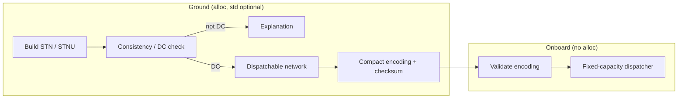

# temporal-control: design

Status: draft for milestone 1. Sections marked *planned* describe intent, not code.

## 1. Purpose and boundaries

`temporal-control` is a narrow, verifiable component: it decides whether a set of timing
constraints can be met, derives an executable strategy, and executes it onboard. It is meant to
be adopted by an existing flight executive (F Prime, cFS) through thin adapters. It is not a
planner, not an executive, and it does not reason about resources.

Non-goals: activity selection (mission planner), resource safety (`resource-timeline`),
physical-state safety (`polyzonotope-reach`), fault protection (the executive).

## 2. Time model

- Time is an integer number of `Ticks(i64)`. The tick length is fixed by the integrator.
- No floating point anywhere: results are bit-identical on every target.
- All arithmetic is checked. Overflow is a reported error (`Error::Overflow`), never a wrap or
  a saturation that could silently change a verdict.
- `i64::MIN` is not a valid lower bound because its negation is not representable;
  construction rejects it.

## 3. Formal semantics

### 3.1 Simple Temporal Network (STN)

An STN is a pair `S = (T, C)` of time points `T = {t_0, ..., t_{n-1}}` and binary constraints
`c = (t_i, t_j, lo, hi)` meaning `lo <= t_j - t_i <= hi`, where `lo, hi` are in
`Z ∪ {-∞, +∞}` (Dechter, Meiri and Pearl 1991).

A *schedule* is a function `σ: T -> Z`. It *satisfies* `S` if every constraint holds for
`σ(t_j) - σ(t_i)`. `S` is *consistent* iff some schedule satisfies it.

**Distance graph.** `G(S)` has one vertex per time point and, per constraint,

- an *upper edge* `t_i -> t_j` with weight `hi` (if `hi` is finite), and
- a *lower edge* `t_j -> t_i` with weight `-lo` (if `lo` is finite).

An edge `u -> v` with weight `w` encodes `t_v - t_u <= w`. Parallel edges are allowed; only the
smallest weight per ordered pair matters. Self-loops are allowed; a self-loop with negative
weight is a one-edge negative cycle.

**Theorem (DMP 1991).** `S` is consistent iff `G(S)` has no negative cycle. If it is
consistent, `σ(t) = d(s, t)` (shortest distance from a virtual source `s` with zero-weight edges
to all time points) satisfies `S`.

**Minimal network.** For a consistent `S`, let `D[i][j]` be the shortest-path distance
`t_i -> t_j` in `G(S)` (`+∞` if none). The minimal network replaces each pair's interval with
`[-D[j][i], D[i][j]]`. It is the tightest equivalent STN: for every pair and every value `x` in
that interval, some satisfying schedule has `σ(t_j) - σ(t_i) = x`. In particular each bound is
attained (*tightness*), which the property tests check.

**Explanation of inconsistency.** A negative cycle `e_1, ..., e_k` in `G(S)`, where every edge
is named by `(ConstraintId, Bound::{Upper, Lower})`. Summing the encoded inequalities around the
cycle gives `0 <= Σ w(e_i) < 0`, a contradiction. So the named constraint bounds are a
certificate of inconsistency that anyone can recheck without trusting the solver. The cycle
found is simple (each vertex at most once) but not necessarily minimum in size or weight.

### 3.2 STN with Uncertainty (STNU)

An STNU adds *contingent links* `(A, l, u, C)` with `0 < l <= u < ∞` (Morris, Muscettola and
Vidal 2001): once the activation point `A` is executed, nature sets the contingent point `C` to
some time in `[A + l, A + u]`. The agent only learns `C` when it happens. Contingent points
are distinct: each is the target of exactly one contingent link (`Stnu::add_contingent_link`
creates it), and the agent never executes it. Activation points may themselves be contingent
(chains). The remaining constraints are *requirement* constraints, as in an STN. `l = u` is
accepted (a degenerate but harmless link); `l = 0` is rejected.

A *situation* `ω` fixes every contingent duration. A *dynamic execution strategy* decides, at
each time, which executable time points to execute, using only the contingent durations
observed so far.

**Dynamic controllability (DC).** An STNU is DC iff there is a dynamic strategy that satisfies
all requirement constraints in every situation.

**Reaction-time semantics (decided).** Time is integer ticks. Within one tick, nature's
contingent events happen first, then the agent decides, so an observation at tick `t` may
trigger an execution at the same tick `t` (*instantaneous reaction at tick granularity*).
Formally, the agent's choice at `t` may depend on every contingent time `<= t`.

This reverses the intent previously written here (decide only on observations strictly before
`t`, i.e. react at `t + 1`). Reasons:

- The edge-generation rules implemented (no-case, upper-case, lower-case with a strictly
  negative tail, cross-case, label removal) decide exactly this variant. The test suite checks
  every checker against a brute-force solver of the integer-time game with both move orders:
  they match the same-tick game on random small STNUs. Example: `A => C [1, 10]` with
  `t_X = t_C` is DC under same-tick reaction and not DC under next-tick reaction.
- A first attempt at a next-tick variant (making the lower- and cross-case conditions
  non-strict) did not match the next-tick game on contingent chains and was dropped. Missing
  piece, in hindsight: label removal would also have needed the `ε` shift.

Consequence for integrators: the executive must hand observations of tick `t` to the dispatcher
before asking it what to execute at `t` (`Dispatcher::step` does this). If the platform can only
react one tick later, the guarantees do not hold. Next-tick DC implies same-tick DC (also
tested).

**Next-tick reaction (done, `Stnu::with_reaction(Reaction::NextTick)`).** Instead of new rules,
a transformation: replace every contingent point `C` by its observation `C' = C + 1`. A link
from an executable point becomes `[lo + 1, hi + 1]`, a link from a contingent point keeps its
bounds (both ends move), and requirements are rewritten with `C = C' - 1`. A same-tick agent
of the new network sees exactly what a next-tick agent of the old one sees, so every checker
and dispatchable-network algorithm applies unchanged; the tests check all checkers against the
next-tick game, including contingent chains, and simulate the resulting networks. Executing it
needs an executive that hands each observation to the dispatcher one tick late, as the shifted
point.

### 3.3 Dispatchable networks and execution

A network is *dispatchable* if a greedy dispatcher that only propagates to immediate neighbors
never violates a constraint (Muscettola, Morris and Tsamardinos 1998).

**STN.** `MinimalNetwork::dispatchable` filters the minimal network (the result is minimal
except for the edge copies on simultaneous points described below). Rigid components
(`D[i][j] + D[j][i] = 0`) get a leader, their earliest member (lowest index on ties); members are
tied to it by two edges. Among leaders, a non-negative edge `A -> C` is dropped if a
non-negative `B -> C` has `D[A][B] + D[B][C] = D[A][C]`, a negative `A -> C` if a negative
`A -> B` does. Members at offset zero from their leader get a copy of every kept leader edge so
that their window always equals the leader's (otherwise they could run first with an
unconstrained window). Tests check that the filtered network has the same minimal network as
the original, and that random, earliest and latest agents never fail.

**STNU.** `Stnu::dispatchable` returns an *extended* network: ordinary edges plus *waits*
`(X, C, δ)`, upper-case edges `X -> A_C` of weight `-δ`: `X` must not execute before `A_C + δ`
unless `C` was observed. `DispatchAlgorithm` picks the source:

- `Morris2014`: Morris's dispatchable variant of his DC algorithm, which inserts every ordinary
  edge and wait its backpropagation derives (one upper-case pass per link activated at a node,
  then one ordinary pass; no normal form, as in CSTNU-Tool's `applyMorris2014Dispatchable`).
  `O(n m + n^3)` for `k <= n`.
- `Minimal` (default): `Morris2014` followed by `minDispESTNU` (Hunsberger and Posenato, ICAPS
  2024): stand-in edges, STN dominated-edge filtering, removal of the remaining stand-ins and of
  dominated waits. The paper's diamond stand-ins are left out: they are only entailed through
  propagation along waits, which the paper's `RTE*` executor does and this dispatcher does not;
  with them a deadline was lost (regression test). So the output is smaller than Morris's
  (about 15-20 % fewer edges and waits on the random test networks, a quarter of the
  closure's) but not proven minimal. `O(k n^3)`.
- `Closure`: the all-pairs labelled closure (unbounded rounds), kept as the reference.

All three are checked by simulating the dispatcher under every agent and nature policy against
every requirement; for `Minimal` this is the only evidence of dispatchability.

**Execution semantics (onboard, `Dispatcher<N, E>`).** Per time point: a window `[lb, ub]`, the
number of unhappened heads of its *precedence* edges (edges of negative weight), and the time it
happened. When a point happens at `t`, only its own edges propagate: `x -> y` with weight `w`
gives `ub[y] <= t + w`, and `y -> x` gives `lb[y] >= t - w`. An executable point may execute at
`now` iff all its precedence heads happened, `lb <= now <= ub`, and each of its waits is
released (contingent observed, or activation happened at `a` and `now >= a + δ`). A tick
(`step`) ingests observations, reports missed deadlines and overdue contingent points, then
executes as soon as possible; `can_execute`/`execute` let an executive choose later times
itself. Errors are typed: missed deadline, contingent out of bounds (assumption violated),
constraint violated or empty window (the network was not dispatchable), time going backwards,
capacity. Observations are recorded even when they violate an assumption, so monitoring
continues. The dispatcher never panics on any input; all tick arithmetic is checked.

## 4. Algorithm choices

| Problem | Algorithm | Cost | Status |
| --- | --- | --- | --- |
| STN consistency + witness schedule + negative cycle | Bellman-Ford from a virtual source, predecessor walk for the cycle | `O(n m)` time, `O(n + m)` memory | done |
| STN minimal network | Floyd-Warshall with early negative-diagonal stop | `O(n^3)` time, `n^2` cells | done |
| STN minimal network, sparse | Johnson (BF potentials + Dijkstra per source) or P³C (Planken, de Weerdt and van der Krogt 2008) | `O(n m + n^2 log n)` | later, only if needed |
| STN incremental consistency | keep the closed matrix; reject a constraint closing a negative cycle | `O(n^2)` per constraint, `n^2` cells | done |
| Extended dispatchable STNU (default) | Morris 2014 dispatchable variant, then `minDispESTNU` without diamond stand-ins | `O(n m + k n^3)` | done |
| Extended dispatchable STNU, reference | closure of the labelled graph in matrix form (`D` n×n, `W` n×k), rounds until fixpoint, all-max projection check | `O(n^3 + n^2 k)` per round, rounds bounded only by the budget (no proven bound) | done |
| STNU DC check (default) | Morris 2014 backpropagation from negative nodes, one linear-scan Dijkstra per node on Morris's normal form (each link gets its own activation node and lower bound 0), as in CSTNU-Tool's `applyNormalForm` | `O(n m + n^3)`, i.e. `O(n^3)` for `m = O(n^2)`; proof in `stnu/morris.rs` | done |
| STNU DC check, RUL⁻ | Cairo, Hunsberger and Rizzi 2018, with contingent activation points normalised to executable ones | `O(n m + k (m + k n) log n)` with a binary heap (paper: `O(mn + k^2 n + k n log n)`) | done |
| STNU DC check, RUL2021 | Hunsberger and Posenato AAAI 2022, Algorithms 1-7: one recursive pass per upper-case edge, resumed after interruptions, only length-preserving edges inserted, CC loops checked by forward propagation | as RUL⁻ | done |
| STNU DC check, cross-check | per-label backpropagation: Morris-style, one propagation per kind of negative in-edge, no normalisation | `O(n (k + 1) (m + n^2) log n)` | done |
| Non-DC explanation | semi-reducible negative cycle collected while Morris's nested propagations unwind, in compact form (each derived edge once, lazily expandable) | `O(n^3)` compact; expansion up to `3 * 2^k - 2` edges | done |
| Dispatchable STN | minimal network + dominated-edge filtering (MMT 1998) | `O(n^3)` | done |

Two independent algorithms per question are a deliberate choice: they cross-check each other
in tests and, on the ground, at runtime. `Stn::minimal_network` already does this: if
Floyd-Warshall finds a negative cycle, Bellman-Ford extracts the explanation, and disagreement
is reported as `Error::Internal` instead of a verdict.

Floyd-Warshall on inconsistent input normally lets distances diverge. Here round `k` only runs
if `D[k][k] >= 0`; a negative cycle whose highest vertex is `k` already shows on that diagonal
entry, and up to that point every entry is an exact restricted shortest path. So overflow can
only occur if a genuine shortest path overflows `i64`.

## 5. Ground versus onboard



| Part | Allocation | Notes |
| --- | --- | --- |
| `Ticks`, `Budget`, `Error` | none | always available |
| STN, STNU, DC checking, explanations, dispatchable generation | `alloc` (default feature) | ground side; may also run onboard on a capable processor |
| Compact dispatchable encoding, validator, dispatcher | none | caller-provided buffers or const-generic capacity; `O(degree)` work per event |

The onboard side must work without `alloc`: it validates a received encoding (bounds, indices,
checksum, structural invariants such as "every contingent link has a valid activation point")
against fixed capacities and refuses anything that does not fit. It never runs a DC check. An
optional bounded *incremental* re-check (for replanning after a reset) is a later decision.

## 6. Budgets and error model

- Every algorithm takes a `Budget { max_steps, max_cells }`.
  - A *step* is one edge relaxation (Bellman-Ford) or one matrix-cell update (Floyd-Warshall).
  - `max_cells` bounds the largest matrix allocation; the check happens before allocating, and
    the Floyd-Warshall matrix uses `try_reserve_exact`, so its allocation failure is
    `Error::OutOfMemory` and not an abort. *Gap:* the `O(n + m)` allocations (Bellman-Ford
    state, the cycle vector, `Stn` construction) are not yet budgeted and abort on allocator
    failure; switch them to `try_reserve` before any onboard use of the `alloc` parts. The
    same holds for the STNU checkers' adjacency lists and derived edges (see below). The `IncrementalStn` working copy of its matrix
    is fallible but not counted in `max_cells`, so the peak is twice the counted `n^2`. `Stn::dispatchable` and the rejection explanation of
    `IncrementalStn::add_constraint` meter each phase against the full budget, so they can
    spend up to twice `max_steps`. The same holds for every STNU checker other than Morris 2014
    on a negative verdict, because the explanation comes from a fresh Morris run.
    `Stnu::check_controllability` (Morris) checks `(n + k)^2` cells and RUL⁻ `k n` cells
    against `max_cells`, but their allocations are infallible; the per-label backprop ignores
    `max_cells`.
- Exhaustion returns `Error::BudgetExhausted` or `Error::MemoryBudgetExceeded`. It never
  returns a partial or guessed verdict. Property test: for any budget, the result is either a
  budget error or identical to the unlimited result.
- Verdicts are not errors: `Verdict::Consistent(certificate)` or
  `Verdict::Inconsistent(NegativeCycle)`. Both carry checkable certificates (a schedule, or a
  negative cycle of named constraint bounds).
- `Error::Internal` means two independent checks disagreed or an invariant broke. The safe
  reaction for an executive is the same as for an inconsistent plan: do not dispatch.
- Onboard (planned): the dispatcher has fixed capacities. Capacity, out-of-window observations
  and missed deadlines are reported as typed events; the dispatcher never panics and never
  executes a point outside its window.

## 7. Explanation format

Current (STN):

```text
NegativeCycle {
    edges: [CycleEdge { constraint: ConstraintId, bound: Upper | Lower }, ...],  // traversal order
    weight: Ticks,                                                              // < 0
}
```

Edges chain: the head of each edge is the tail of the next, and the last closes the cycle.
`Bound::Upper` is the edge `from -> to` with weight `hi`; `Bound::Lower` is the edge `to -> from`
with weight `-lo`. A consumer rechecks the cycle from its own copy of the constraints.

STNU (done): a non-DC verdict carries a semi-reducible negative cycle.

```text
SemiReducibleCycle {
    steps:   [Edge(LabelledEdge) | Derived(index), ...],   // top level, traversal order
    derived: [DerivedEdge { from, to, weight, steps: [...] }, ...],  // each once, inner first
    weight:  Ticks,                                  // < 0, lower-case at lo, upper-case at -hi
}
LabelledEdge = Requirement(CycleEdge) | LowerCase(ContingentId) | UpperCase(ContingentId)
```

The compact form lists each derived edge (an ordinary edge the checker inferred, with the path
it summarises) once, so it has `O(n^3)` steps; `edges()` expands it lazily into original
edges, which can be exponentially many in `k` (Hunsberger's magic loops need `3 * 2^k - 2`).
For operators, a derived edge reads as an intermediate conclusion ("X must follow Y by at most
w, because ..."). The expanded edges chain like an STN cycle (`LabelledEdge::resolve` gives
tail, head and weight). An
upper-case edge reads "if this link takes its full duration", a lower-case edge "if it ends as
early as possible"; `SemiReducibleCycle::contingent_links` lists the links involved. The cycle
is not necessarily simple or minimal. Checked property: keeping only its requirement bounds
(and all links) still gives a network that is not DC. Waits are not named separately: they are
intermediate edges of the reduction, not inputs. Matching CSTNU-Tool's explanations
structurally is still open.

## 8. Testing strategy

| Layer | What | Status |
| --- | --- | --- |
| Example tests | Hand-written networks with known answers (rover example) | done |
| Property tests (proptest) | BF and FW agree; schedules satisfy all constraints; cycles chain, close and are negative when recomputed from the STN's own constraints; minimal network is sound and tight; budgets never change a verdict; extreme `i64` values give a verdict or `Overflow` but never panic; generator yields both verdicts > 20 % | done |
| Differential (ground) | DC verdicts against CSTNU-Tool on its STNU benchmarks (`STNUBenchmark2020`, tied to Hunsberger and Posenato AAAI 2022) and on random STNUs; import CSTNU-Tool's file format (GraphML is assumed, **unverified**) in a dev-only tool | milestone 2 |
| Brute-force oracle | Integer-time execution game solved exhaustively (both move orders) on STNUs with up to 3 executable points and 2 links; every checker and dispatchable-network algorithm must match the same-tick game, and on the next-tick transformation the next-tick game; next-tick DC implies same-tick DC; mutations (run by hand, recorded in the commit messages) must make it fail: closure rules and unsuitability; Morris unsuitability, recursion, lower-case edges, derived edges, stop at non-negative distance, normalisation; RUL⁻ non-length-preserving Upper⁻, blocker check, Lower⁻, the `u - l` bound, seeding with the own lower-case edge, normalisation | done |
| Differential (internal) | Incremental STN vs from-scratch Floyd-Warshall after every constraint; every STNU checker vs the closure on STNUs up to 7 executable points and 4 links; STNU without links vs STN; filtered STN vs its minimal network | done |
| Explanations | Every SRN cycle chains, closes with its stated negative weight, and its requirement bounds alone are not DC (oracle on small, closure on medium networks) | done |
| Simulated dispatch | DC networks (and dispatchable STNs) under ASAP, latest and random agents and min, max and random nature: no dispatcher error, every requirement and contingent bound holds | done; resets and overruns: milestone 4 |
| Fuzzing | `cargo fuzz` targets for construction, the checks, and the onboard decoder/validator (must reject, never panic) | milestone 2 (decoder: milestone 3) |
| Model checking | Kani harnesses for the dispatcher step function and the decoder on small fixed capacities: no panic, no overflow, windows respected | milestone 3 |
| Simulation | deterministic replay with injected contingent durations and resets: DC network plus dispatcher never violates a requirement constraint | milestone 4 |

## 9. Milestones

1. **STN** (done on `draft/initial`): construction, BF consistency with witness or negative
   cycle, FW minimal network, budgets, property tests, `thumbv7em-none-eabihf` build.
2. **STNU and DC**: contingent links, labelled-closure checker, Morris 2014 `O(n^3)` checker,
   RUL⁻, RUL2021, per-label backprop, SRN-cycle explanations, brute-force oracle (done). Open:
   CSTNU-Tool differential harness, fuzz targets.
3. **Dispatchable form and onboard dispatcher**: minimal dispatchable STN, bounded and reduced
   dispatchable ESTNU (Morris 2014 dispatchable + `minDispESTNU` without diamonds),
   `no_std`/no-`alloc` dispatcher with fixed capacity and input validation, incremental STN
   consistency (done). Open: provably minimal ESTNU for this dispatcher (or an `RTE*`
   dispatcher), compact encoding with checksum, Kani harnesses.
4. **Simulation**: deterministic simulator with injected durations, resets and overruns.
5. **Adapters**: F Prime (WebAssembly sequencing) and cFS demonstrators, in separate crates.

## 10. Cross-crate needs

- **`resource-timeline`**: it needs the time windows of activities to check resource profiles.
  Proposed contract, without a Cargo dependency in either direction: both crates use `i64`
  ticks with the same tick length, chosen by the integrator; `temporal-control` exposes per-point
  windows (minimal network rows from a reference point) and the dispatcher's committed times;
  `resource-timeline` returns conflicts as time intervals the planner can turn into extra
  precedence constraints for this crate. Whether a shared `Ticks` type is worth a tiny common
  crate is an open question; today both crates should accept plain `i64`.
- **`miniplan`** (optional adapter, feature flag on the miniplan side): converts temporal plans
  into STNUs.
- **`robust-planning`** (optional): may supply contingent bounds derived from reachability.
  Those bounds are assumptions; the guarantees do not compose automatically (see the
  spaceflight track).

## 11. Open questions

- Reaction time (see 3.2). Default chosen: same-tick reaction; next-tick is available by
  transformation. Needs confirmation which one the target executive delivers. Also confirm
  which variant the CSTNU-Tool STNU checker uses before differential testing. Reaction delays
  of more than one tick would generalise the transformation (`C' = C + ε`); not exposed.
- Minimal ESTNU: the default network is bounded and reduced, but its dispatchability rests on
  Morris's theorem for the unreduced network plus simulation for the reduction. Either prove
  the reduction for this dispatcher, or implement `RTE*` (propagation along waits) onboard and
  enable the diamond stand-ins for a truly minimal network. Default: no diamonds.
- Morris 2014 itself was not available. The implementation follows its description in
  Hunsberger and Posenato (2023, section 2.1.1) and CSTNU-Tool's `applyMorris2014`,
  `applyNormalForm` and `morris2014DCBackpropagation` (read, not copied); compare with the
  paper before citing it publicly.
- Explanations: the compact form avoids the exponential expansion. The TIME 2024 SRN-cycle
  finder (Hunsberger and Posenato) would give shorter cycles; not implemented. Whether
  operators want the nested form or a minimal expanded cycle is open.
- Whether the onboard network must be smaller still to fit fixed capacities; the default is
  reduced, but its worst case is still `n^2` edges plus `n k` waits.
- Dispatcher policy: `step` executes as soon as possible. Whether flight use needs other
  built-in policies (as late as possible, preferred times) or leaves that to the executive via
  `can_execute`/`execute`.
- Whether onboard incremental re-checking is required, and its budget.
- Whether contingent links with `l = 0` must be supported (some literature allows `0 <= l`).
- Encoding format for the dispatchable network (versioned, checksummed; fixed-width integers).
- Whether `usize` handles are acceptable for the onboard encoding or a `u16`/`u32` index type is
  needed.

## References

Verified against the CSTNU-Tool page
(<https://profs.scienze.univr.it/~posenato/software/cstnu/>):

- L. Hunsberger and R. Posenato. Speeding up the RUL⁻ dynamic-controllability-checking
  algorithm for Simple Temporal Networks with Uncertainty. AAAI 2022.
- L. Hunsberger and R. Posenato. Sound-and-complete algorithms for checking the dynamic
  controllability of Conditional Simple Temporal Networks with Uncertainty. TIME 2018.

Read in full while implementing the STNU checkers:

- M. Cairo, L. Hunsberger and R. Rizzi. Faster dynamic controllability checking for Simple
  Temporal Networks with Uncertainty. TIME 2018, LIPIcs 120, 8:1-8:16 (RUL⁻, Algorithms 1-3).
- L. Hunsberger and R. Posenato. A faster algorithm for converting simple temporal networks
  with uncertainty into dispatchable form. Information and Computation 293, 2023 (section
  2.1.1 describes Morris 2014).

From memory, **not verified** (check before citing in public material):

- R. Dechter, I. Meiri and J. Pearl. Temporal constraint networks. Artificial Intelligence 49,
  1991.
- N. Muscettola, P. Morris and I. Tsamardinos. Reformulating temporal plans for efficient
  execution. KR 1998.
- P. Morris, N. Muscettola and T. Vidal. Dynamic control of plans with temporal uncertainty.
  IJCAI 2001.
- L. Hunsberger. Fixing the semantics for dynamic controllability and providing a more
  practical characterization of dynamic execution strategies. TIME 2009.
- P. Morris. Dynamic controllability and dispatchability relationships. CPAIOR 2014, LNCS
  8451 (bibliographic data verified; content only known through the two papers above).
- N. Bhargava, T. Vaquero and B. Williams. Faster conflict generation for dynamic
  controllability. IJCAI 2017.
- L. Planken, M. de Weerdt and R. van der Krogt. P³C: a new algorithm for the simple temporal
  problem. ICAPS 2008.
